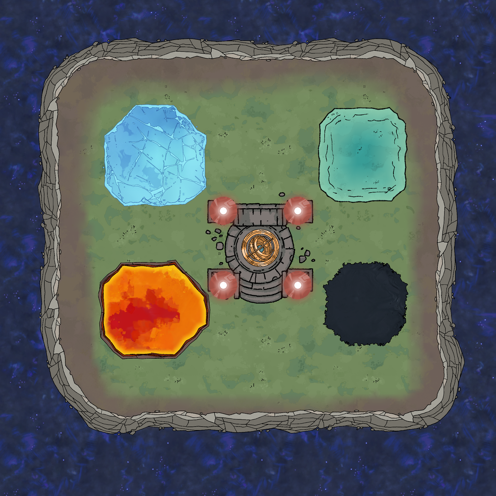
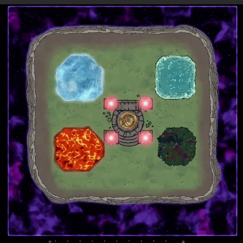
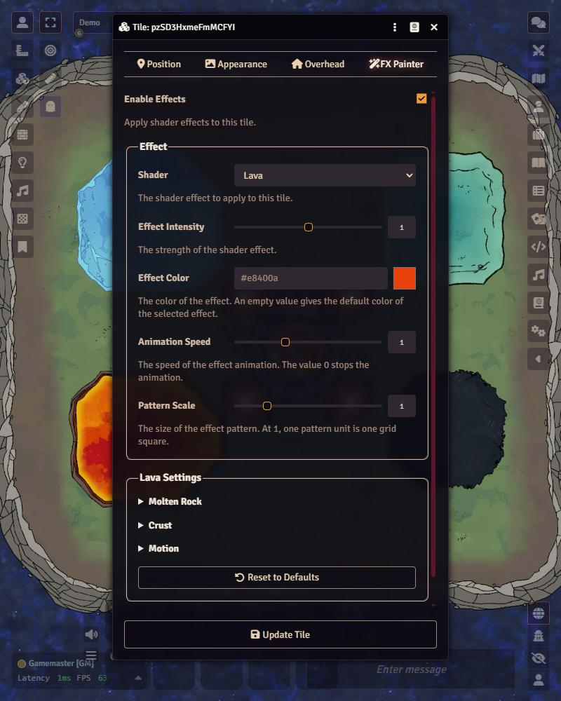
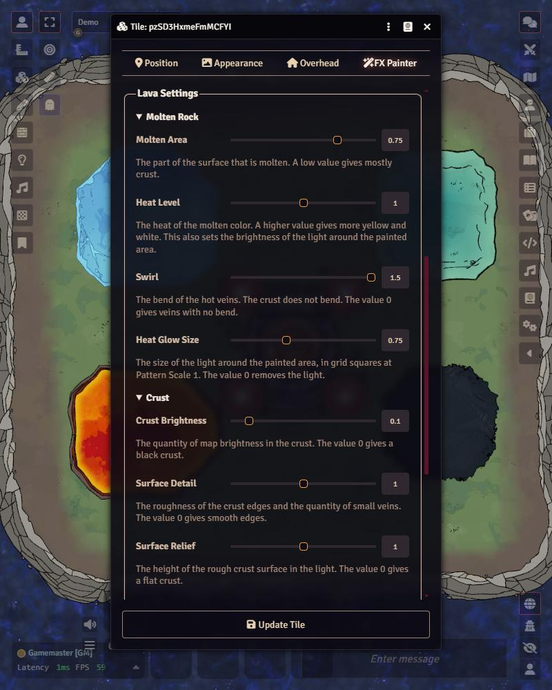
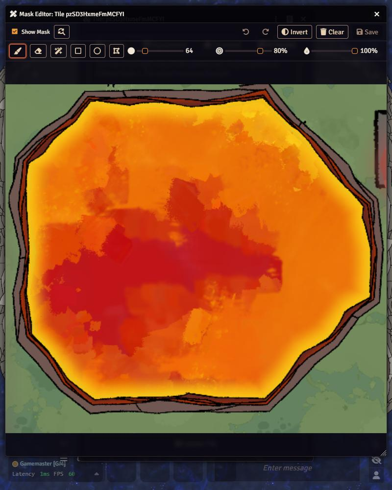

# Tile FX Painter

Tile FX Painter is a module for Foundry VTT. It adds animated shader effects to tiles. You paint a mask on a tile, and the effect shows only in the painted area.

The module was made for Foundry VTT. It supports V13 and V14.

## Before and After

### Before

The demo map with no effects. Demo map was created using Dungeondraft.

### After

The same map with the effects.

## Effects

| Effect | Description |
| --- | --- |
| Glow | A light with a soft halo. The halo can go past the tile frame. |
| Metallic | Brushed metal. The reflections move with time and with the camera. |
| Liquid | A dark liquid with a rainbow film, small ripples, and wet highlights. |
| Lava | Solid crust on molten rock, with hot veins. A soft light can go past the tile frame. |
| Water | Clear water with surface waves, light patterns on the bottom, and foam at the shore. |
| Frost | A sheet of ice with cracks, sparkles, and fog along the mask border. |
| Astral Void | A hole into space, with stars and color clouds. It does not use the map color. |

## Tile Settings

The tile configuration window has an FX Painter tab. Use this tab to enable an effect on the tile and to change it.

Expand a group to show its settings. The text below each setting explains what it does.

## Mask Editor

The Mask Editor shows the area of the background image under the tile.

The editor has these tools:

- Brush, with size, hardness, and opacity
- Eraser
- Color select
- Rectangle
- Ellipse
- Polygon

The editor can also invert the mask, clear the mask, undo a change, and redo a change.

The module saves each mask as a small grayscale PNG in the tile data. Thus a scene export or a compendium keeps the masks. The module continues to show the mask files of version 0.1.0. The next save of the tile embeds the mask.

## Performance

The module was tested with more than 70 tiles, all with shader effects. The test showed no noticeable performance decrease.

## Limits

- Only users with the permission to update the tile can open the Mask Editor.
- You must create a tile before you can open the Mask Editor for it.
- The effects use only the background image under the tile. They do not use other tiles or tokens.
- Video backgrounds are not supported.
- While you drag a tile, the effect stays at the old position.

## Installation

1. Put the module directory in the Foundry `Data/modules/` directory. The directory name must be `tile-fx-painter`.
2. Start Foundry VTT.
3. Enable the module in a world.

Or it can be downloaded from Foundry directly.

## AI Disclaimer

This module was coded the help of AI for the following:

- Write the code comments.
- Assist with the shader code.
- Understand the Foundry API and how to attach code to its hooks.

## License

The module has the MIT License. Refer to [LICENSE](LICENSE).
